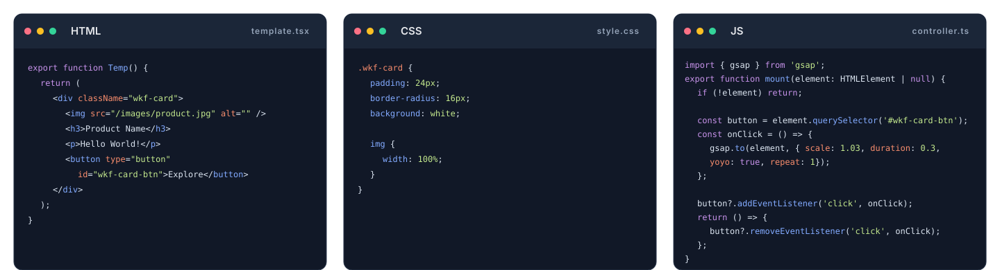
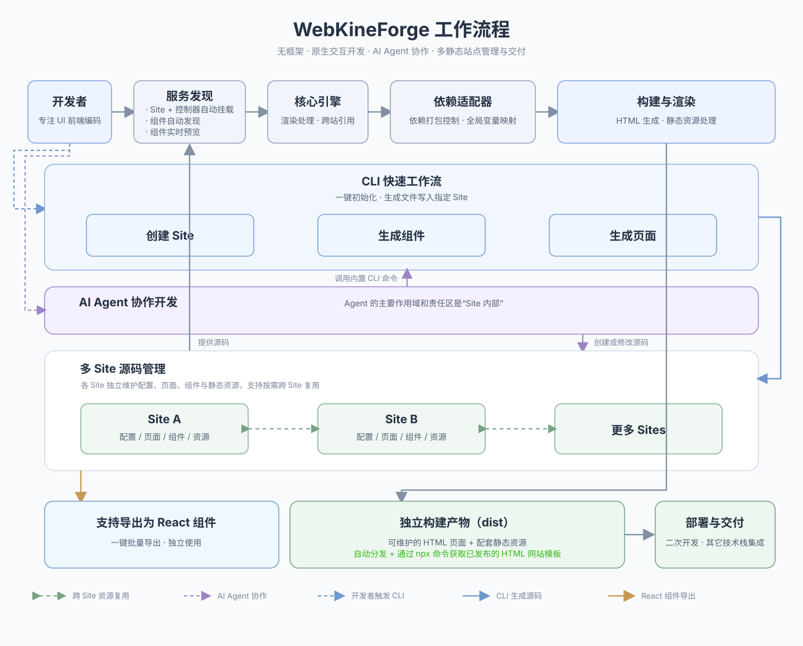

# WebKineForge

<p align="center">
  <a href="https://github.com/xizon/WebKineForge">
      
  </a>
</p>

<p align="center">
  
</p>


<p align="center">
  🇺🇸 <b><a href="./README.md">English</a></b> &nbsp;|&nbsp; 🇨🇳 简体中文
</p>


**面向创意开发者的交互式网页创作系统，生成结构清晰的静态 HTML，并支持 AI Agent 协作开发。**

一条 `npx` 命令，即可下载 WebKineForge 中任意已发布 Site 的 HTML 网站模板，本地运行、自由定制、集成与部署。

```bash
npx webkineforge list
npx webkineforge add default-site
```

---

## ☀️ 它适合你吗？

| 你的需求 | 推荐 | 运行时开销 | 需要掌握 | AI 协作 | 模板获取 |
|---|---|---|---|---|---|
| 交互动效、干净的 HTML 静态模板 | **WebKineForge** | 零框架运行时 | HTML / JS / CSS (可选：Tailwind) | 内置 Agent，简单安全 | 构建生成 / `npx` 命令一键拉取 |
| 内容为主、少量交互 | **[Astro](https://astro.build)** | 零 JS 默认（Islands 按需） | Astro 组件语法 + 前端基础 | 依赖自身约定，无专门索引 | 官方主题 / Starlight |
| 全栈应用、实时数据 | **[Next.js](https://nextjs.org)** / **[Nuxt](https://nuxt.com)** | React/Vue 运行时 | 框架全家桶 | 生态成熟但无统一结构约定 | 模板市场丰富 |
| 设计师可视化建站 | **[Framer](https://framer.com)** / **[Webflow](https://webflow.com)** | 平台托管 | 基本无需代码 | 平台内置 AI | 平台模板库 |
| 极简网站 | **[11ty](https://www.11ty.dev)** / 纯手写 | 零 | 几乎为零 | 完全靠人工约定 | 无 |

## ⚠️ 什么时候别选我

WebKineForge 不做后端、鉴权和数据库。但它的 HTML 产物随时可以二次开发，集成进 Next.js、WordPress、PHP、Java 等任何技术栈——前端归你自由发挥，后端交给你的主系统。

---

## 简介

无需运行时框架，也无需学习额外的 API。直接使用 HTML、TypeScript、Tailwind CSS 与原生 CSS 开发组件和页面。

构建后输出独立的 HTML 页面及配套资源，可直接部署，也可集成到 PHP、Java、WordPress、Next.js 等任意技术栈中。采用 **Site 即创作沙盒**架构，每个 Site 拥有独立的页面、组件、样式与模板，并支持跨 Site 按需复用组件和静态资源。

系统采用 **Site 即创作沙盒** 的独立多站点架构：
- **自由创造**：每个 Site 拥有独立的页面、组件、样式与模板。
- **按需复用**：支持跨 Site 一键引用组件与静态资源。




## 术语

| 术语 | 说明 |
|---|---|
| **Project（项目）** | 整个工作空间，可以包含一个或多个 Site |
| **Site（站点）** | 工作空间中的一个独立网站项目 |
| **Page（页面）** | Site 内的具体网页 |
| **Component（组件）** | Site 内可复用的 UI 或交互功能单元 |
| **Website（网站）** | 由 Site 最终构建生成、供访客访问的网站。也可以通过 `npx` 下载 Site 的构建成品，作为**网站模板**使用 |

一个 Project 可以包含多个 Site，每个 Site 都可以独立构建，最终生成可独立部署的 Website。


## 功能特性

### 🛠️ 开发体验

- **简单开发**：无需掌握主流前端框架（如 React、Vue），只需在 `sites/` 工作区开发和管理网页。
- **快速创建工作流**：内置 CLI，支持一键创建 Site、组件和页面，减少重复的初始化工作。
- **三层分离架构（推荐，非强制）**：每个组件由 **Template**（TSX，HTML 结构）、**Controller**（TypeScript，交互逻辑）、**Style**（Tailwind CSS / 原生 CSS）三部分组成，职责独立。对于简单组件，也可以省略 Controller 和 Style，详见[灵活写法](./docs/zh-CN/adding-components.md#73-灵活写法)。
- **自动挂载与实时预览**：自动发现、注册和初始化组件，采用原生 JS，无需额外 API。可在浏览器中实时预览组件效果。
- **原生交互生态**：基于原生 JavaScript，可自由集成 GSAP、Three.js、anime.js、jQuery、SVG.js 等库。
- **外部库复用**：支持引用网站中已加载的第三方库，避免重复打包，方便集成。
- **跨栈复用**：可一键将原生组件批量导出为 React 组件库。
- **AI 协作开发**：内置 Agent，可用 Cursor、Codex、Claude Code 等高效率开发组件与页面。
- **Site 级创作沙盒**：不同网站拥有独立的目录、配置、组件、页面和构建产物，互不干扰，支持 CLI 快速初始化。
- **跨 Site 资源复用**：多个 Site 之间可以互相引用组件及静态资源，无需集中管理。


### 🔍 SEO 与多页面

- **SEO 配置**：支持站点级和页面级配置，自动生成规范的 `<meta>` 与 Open Graph（`og:`）标签。
- **多页面索引**：页面之间可用相对链接互相跳转，构建时自动生成 `index.html` 导航页，方便预览。

### 🚀 构建与交付

- **网站模板一键获取**：通过 `npx` 命令 一键下载构建后的可维护 HTML 网站模板到本地，直接用于集成和部署。详见[下载网站模板](./docs/zh-CN/website-templates.md)。
- **独立构建**：每个 Site 都可以单独构建，生成完整、可独立运行的网站。
- **轻量静态构建**：页面及配套资源输出为独立静态文件，无需运行时框架。
- **可维护的 HTML**：输出结构清晰，便于二次开发，可通过 CDN、Nginx 或静态托管部署。
- **降低样式冲突**：每个 Site 独立配置 Tailwind 前缀。`前缀:` 用于 Tailwind 工具类，`前缀-` 用于自定义 class 和 ID。详见[样式规范速查](./docs/zh-CN/style-conventions.md)。


## 目录

- [1. 快速开始](#1-快速开始)
- [2. 系统架构](./docs/zh-CN/system-architecture.md)
- [3. 配置站点信息](./docs/zh-CN/site-configuration.md)
- [4. 使用 AI Agent](./docs/zh-CN/ai-agents.md)
- [5. 下载网站模板](./docs/zh-CN/website-templates.md)
- [6. 新建 Site](./docs/zh-CN/creating-a-site.md)
- [7. 新增组件](./docs/zh-CN/adding-components.md)
- [8. 新增页面](./docs/zh-CN/adding-pages.md)
- [9. 管理全局样式](./docs/zh-CN/global-styles.md)
- [10. 自定义 HTML 页面模板](./docs/zh-CN/custom-html-template.md)
- [11. 跨 Site 资源复用](./docs/zh-CN/cross-site-reuse.md)
- [12. 在 React 项目中使用组件](./docs/zh-CN/react-integration.md)
- [13. 浏览器与设备兼容性](#13-浏览器与设备兼容性)
- [14. 参与贡献](#14-参与贡献)
- [15. 开发环境](#15-开发环境)
- [16. 支持与感谢](#16-支持与感谢)
- [17. 许可证](#17-许可证)

## 1. 快速开始

环境要求：Node.js 22.12.0+

> **只需要关注 `sites/`**
> 克隆项目并安装依赖后，日常开发只发生在 `sites/` 目录：在自己的 Site 里编写组件、页面、样式和静态资源即可。


### 1.1 安装与启动

```bash
npm install
npm run build
npm run dev     # http://localhost:3000
```

首次使用必须先运行 `npm run build`，生成 TypeScript 配置及 Agent 所需的组件、页面索引文件。

> 构建会为每个 Site 生成 `tsconfig.json`, `component-index.json` 和 `page-index.json`。因此首次使用，必须先运行 `npm run build`，再运行 `npm run dev`。


### 1.2 CLI 命令（调试与构建）

所有 Site 均位于 `sites/` 目录，每个子目录代表一个独立网站。

> 项目自带 `default-site` 示例。目录名、`site.json` 中的 `name` 和 `package.json` 中的 `name` 必须保持一致。

| 命令 | 单站点 | 多站点 |
|---|---|---|
| `dev` | 自动启动 | 指定 Site |
| `build` | 自动构建 | 指定 Site |
| `preview` | 自动预览 | 指定 Site |
| `export:react` | 自动导出 | 指定 Site |
| `typecheck` | 检查 TypeScript | 检查所有配置源码 |

**指定 Site**

```bash
npm run dev -- default-site
npm run build -- default-site
npm run preview -- default-site
npm run export:react -- default-site
```

**批量操作**

```bash
npm run build -- all
npm run export:react -- all
```

**注意事项**

- 每个 Site 独立输出到自己的 `dist/` 目录。
- `dev` 和 `preview` 每次只能运行一个 Site，不支持 `all`。
- 两者默认使用 3000 端口，请勿同时运行。

### 1.3 CLI 命令（快速创建）

| 命令 | 说明 |
|---|---|
| `npm run create:site -- my-site` | 创建 Site |
| `npm run create:component -- "My Component" --site my-site` | 创建组件 |
| `npm run create:page -- "My Page" --site my-site` | 创建页面 |

创建命令均支持可选的 `--prefix`：

```bash
npm run create:site -- my-site --prefix myprefix
npm run create:component -- "My Component" --site my-site --prefix myprefix
npm run create:page -- "My Page" --site my-site --prefix myprefix
```


### 1.4 工作流



### 1.5 Site 开发工作目录

```sh
WebKineForge/
│   ...
└── sites/
    ├── site-a/
    │   ├── src/
    │   │   ├── pages/              # 网站页面
    │   │   ├── components/         # 可复用 UI 组件
    │   │   └── styles/             # 全局样式
    │   │
    │   ├── public/                 # 静态资源
    │   └── dist/                   # 构建输出的网站
    │
    ├── site-b/
    └── site-c/
```


## [2. 系统架构](./docs/zh-CN/system-architecture.md)
## [3. 配置站点信息](./docs/zh-CN/site-configuration.md)
## [4. 使用 AI Agent](./docs/zh-CN/ai-agents.md)
## [5. 下载网站模板](./docs/zh-CN/website-templates.md)
## [6. 新建 Site](./docs/zh-CN/creating-a-site.md)
## [7. 新增组件](./docs/zh-CN/adding-components.md)
## [8. 新增页面](./docs/zh-CN/adding-pages.md)
## [9. 管理全局样式](./docs/zh-CN/global-styles.md)
## [10. 自定义 HTML 页面模板](./docs/zh-CN/custom-html-template.md)
## [11. 跨 Site 资源复用](./docs/zh-CN/cross-site-reuse.md)
## [12. 在 React 项目中使用组件](./docs/zh-CN/react-integration.md)


## 13. 浏览器与设备兼容性

### 13.1 桌面端浏览器

| 浏览器 | 最低版本 |
| ----- | ----- |
| **Google Chrome** | **v112+** |
| **Microsoft Edge** | **v112+** |
| **Apple Safari** | **v16.5+** |
| **Mozilla Firefox** | **v117+** |
| **Internet Explorer** | ❌ **Not supported** |

### 13.2 移动操作系统与设备

| 操作系统/设备 | 浏览器 | 最低 OS 版本 |
| ----- | ----- | ----- |
| **iPhone / iPad** | **iOS Safari** / WebKit | **iOS 16.0.3+** |
| **Android phones / tablets** | **Chrome for Android** | **Android 10+** |


## 14. 参与贡献

我们欢迎开发者通过分享创作、报告问题、提出建议和完善文档等方式参与 WebKineForge 的建设。

### 14.1 分享你的创作

我们欢迎社区开发者创建并分享自己的 Site！

如果你希望将自己的创作贡献给 WebKineForge，可以针对新站点（`sites/{your-site-name}/`）提交 Pull Request。

请按照下方的贡献工作流进行操作。

### 14.2 报告问题与提出建议

如果你在使用过程中遇到问题，或者对项目有任何想法和建议，欢迎通过 GitHub Issues 与我们交流。

- **Bug 报告**：描述遇到的问题、复现步骤以及预期结果。
- **功能建议**：提出你希望增加的功能或改进方向。
- **其他反馈**：分享使用体验、发现的问题或任何有价值的想法。

### 14.3 贡献工作流

1. Fork 并 Clone 项目仓库。
2. 安装依赖：`npm install`
3. 根据贡献类型进行相应的开发或修改。
4. 在本地进行测试，确保修改符合预期。
5. 提交 Pull Request，并清晰描述本次修改的内容和目的。

### 14.4 PR 检查清单

**通用检查清单（适用于所有 PR）**

- [ ] 修改内容符合项目定位和发展方向。
- [ ] 代码遵循现有的项目结构和编码规范。
- [ ] 构建和类型检查通过（适用时）。
- [ ] 不包含无关修改或不必要的生成文件。
- [ ] PR 描述清晰说明了修改内容和目的。

**Site PR 专属检查清单**

- [ ] 所有变更严格限制在 `sites/{your-site-name}/` 目录内。
- [ ] 目录名称使用 kebab-case，并与 `site.json` 和 `package.json` 中的 `name` 保持一致。
- [ ] Site 构建和类型检查均通过。
- [ ] 所有依赖均声明在对应 Site 的 `package.json` 中。
- [ ] 不提交生成文件（`dist/`、`index.json` 文件、`tsconfig.json`）。


## 15. 开发环境

- [Tailwind CSS](https://tailwindcss.com/) **4.x.x+**
- [Vite](https://vite.dev/) **8.x.x+**
- [TypeScript](https://www.typescriptlang.org/) **7.x.x+**
- [Preact](https://preactjs.com/) **11.x.x+**


## 16. 支持与感谢

WebKineForge 是一个开源项目，致力于将纯静态创意交互网站的开发流程工程化，让网站模板的创建、定制、复用、分享与交付变得更加简单高效，让静态网站开发回归创作本身。

我们希望通过工具化、工程化的开发方式，减少繁琐的开发流程，让开发者回归前端创作本身，专注于界面设计与交互体验，享受纯粹的创造乐趣。

如果你觉得这个项目对你有所帮助，你的支持将是我们持续改进与发展的动力！

感谢！

**感谢你对 WebKineForge 的关注与支持！**

## 17. 许可证

Licensed under the [MIT](https://opensource.org/licenses/MIT).

