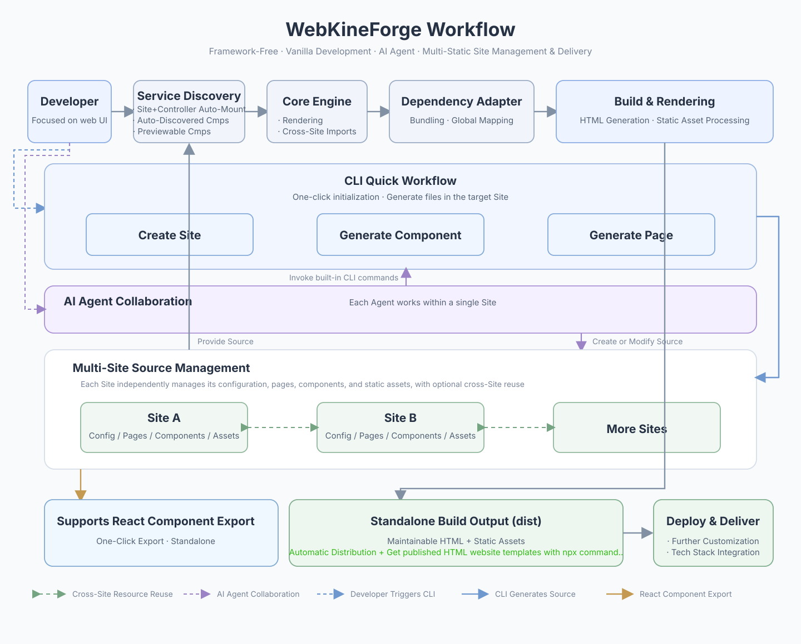

# 2. System Architecture

[🏠 Back to Main README](../../README.md#table-of-contents)




## 2.1 Site Development Workspace

```sh
WebKineForge/
│   ...
└── sites/
    ├── site-a/
    │   ├── src/
    │   │   ├── pages/              # Website pages
    │   │   ├── components/         # Reusable UI components
    │   │   └── styles/             # Global styles
    │   │
    │   ├── public/                 # Static assets
    │   └── dist/                   # Built website
    │
    ├── site-b/
    └── site-c/     
```


## 2.2 Detailed Directory Structure

```sh
WebKineForge/
├── docs                               # Documentation
├── AGENTS.md/CLAUDE.md                # Agent entry point (dispatch only)
├── package.json                       # Root dependencies (requires "workspaces")
├── tsconfig.json                      # TypeScript config
├── vite.config.ts                     # System build config
├── core/                              # Core engine
├── tools/                  
├── sites/                             # Independent Site collection
│   ├── {your_site_name}/
│   │   ├── site.json                  # Site basic configuration
│   │   ├── package.json               # Site-specific dependencies
│   │   ├── site.html                  # Optional Site-level HTML shell (not present by default)
│   │   ├── component-index.json       # Auto-generated component index for Agents
│   │   ├── page-index.json            # Auto-generated page index for Agents
│   │   ├── tsconfig.json              # Auto-generated TS config for cross-site references
│   │   ├── public/                    # Static assets copied to dist during build
│   │   ├── src/
│   │   │   ├── styles/                # Global styles available to components and pages
│   │   │   │   └── tailwind.css       # Tailwind CSS global entry
│   │   │   ├── components/            # Components
│   │   │   │   ├── {your_component}/
│   │   │   │   │   ├── template.tsx   # HTML structure & style imports
│   │   │   │   │   ├── controller.ts  # Browser-side interaction & animation logic
│   │   │   │   │   ├── style.css      # Component styles
│   │   │   │   │   ├── index.ts       # One-line entry: export { Template as default } from './template' (registered and mounted automatically)
│   │   │   │   │   ├── manifest.json  # Component information, parameters, dependencies, and usage examples. 
│   │   │   │   │   └── examples.md    # Examples of components
│   │   │   │   └── ...
│   │   │   └── pages/                 # Pages
│   │   │       ├── {your_page}/
│   │   │       │   ├── index.tsx      # Client and Server entry (including Page layout and component placement)
│   │   │       │   ├── style.css      # Page-specific styles
│   │   │       │   └── manifest.json  # Page information
│   │   │       └── ...
│   │   └── dist/                      # Standalone build output directory
│   │       ├── index.html             # Home page or index navigation
│   │       ├── samplepage-1.html
│   │       ├── samplepage-2.html
│   │       ├── assets/                # Bundled JS / CSS
│   │       └── ...                    # Processed static assets
│   │      
│   ├── {your_site_name}/              # Additional sites (identical structure)
│   └── {your_site_name}/             
```

## 2.3 Three-Layer Component Architecture: Recommended, Not Required

See [7.3 Flexible Authoring](./adding-components.md#73-flexible-authoring).


---


[🏠 Back to Main README](../../README.md#table-of-contents)