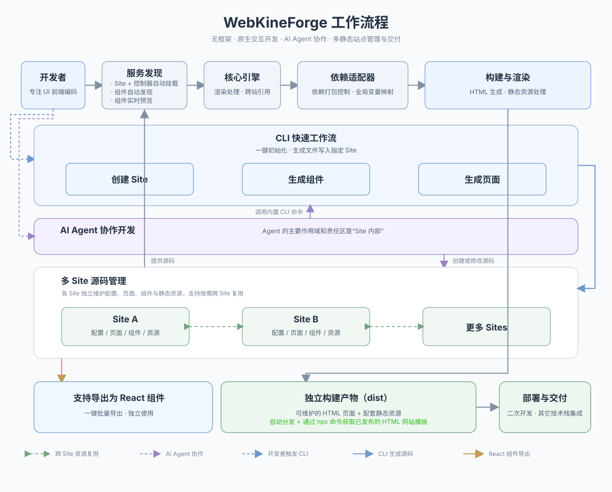

# 2. 系统架构


[🏠 返回项目主文档](../../README.zh-CN.md#table-of-contents)



## 2.1 Site 开发工作目录

```sh
WebKineForge/
│   ...
└── sites/
    ├── site-a/
    │   ├── src/
    │   │   ├── pages/              # 网站页面
    │   │   ├── components/         # 可复用 UI 组件
    │   │   └── styles/             # 全局样式
    │   │
    │   ├── public/                 # 静态资源
    │   └── dist/                   # 构建输出的网站
    │
    ├── site-b/
    └── site-c/
```

## 2.2 详细目录结构

```sh
WebKineForge/
├── docs                               # 文档类
├── AGENTS.md/CLAUDE.md                # Agent 入口，只负责调度
├── package.json                       # 系统底层依赖配置（必须带 "workspaces"）
├── tsconfig.json                      # TypeScript 配置
├── vite.config.ts                     # 系统自身构建配置
├── core/                              # 系统核心工具链
├── tools/ 
├── sites/                             # 独立 Site 集合
│   ├── {your_site_name}/
│   │   ├── site.json                  # Site 基础配置
│   │   ├── package.json               # Site 自身的依赖配置
│   │   ├── site.html                  # 用户自主创建：可选的 Site 级 HTML 文档模板（默认不存在）
│   │   ├── component-index.json       # 构建生成：组件索引（供 Agent 检索）
│   │   ├── page-index.json            # 构建生成：页面索引（供 Agent 检索）
│   │   ├── tsconfig.json              # 构建生成：Site 自身的 TS 配置（跨 Site 资源复用的关键）
│   │   ├── public/                    # Site 静态资源目录（构建时处理并输出到 dist）
│   │   ├── src/
│   │   │   ├── styles/                # 全局样式（可用于组件和页面）
│   │   │   │   └── tailwind.css       # Tailwind CSS 全局入口
│   │   │   ├── components/            # 组件
│   │   │   │   ├── {your_component}/
│   │   │   │   │   ├── template.tsx   # HTML 模板，仅负责 HTML 结构和样式引入
│   │   │   │   │   ├── controller.ts  # 核心动画 / 业务逻辑，仅负责浏览器端交互
│   │   │   │   │   ├── style.css      # 组件样式
│   │   │   │   │   ├── index.ts       # 一行入口：export { Template as default } from './template'（自动注册与挂载）
│   │   │   │   │   ├── manifest.json  # 组件信息、参数定义、依赖和使用说明
│   │   │   │   │   └── examples.md    # 组件示例
│   │   │   │   └── ...
│   │   │   └── pages/                 # 页面
│   │   │       ├── {your_page}/
│   │   │       │   ├── index.tsx      # 客户端和服务端入口（包含页面 HTML 结构，负责组件排列）
│   │   │       │   ├── style.css      # 页面专属样式
│   │   │       │   └── manifest.json  # 页面信息
│   │   │       └── ...
│   │   └── dist/                      # 完整构建输出，可独立预览和部署
│   │       ├── index.html             # 默认首页或页面索引（按构建规则生成）
│   │       ├── samplepage-1.html
│   │       ├── samplepage-2.html
│   │       ├── assets/                # 打包后的 JS / CSS
│   │       └── ...                    # 从 public/ 处理并输出的静态资源
│   │      
│   ├── {your_site_name}/              # 其它 Site，基础结构基本一致，可按需增减配置和内容
│   └── {your_site_name}/             
│ 
```

## 2.3 组件三层架构：强烈推荐，但不强制

详见 [7.3 灵活写法](./adding-components.md#73-灵活写法)。


---


[🏠 返回项目主文档](../../README.zh-CN.md#table-of-contents)